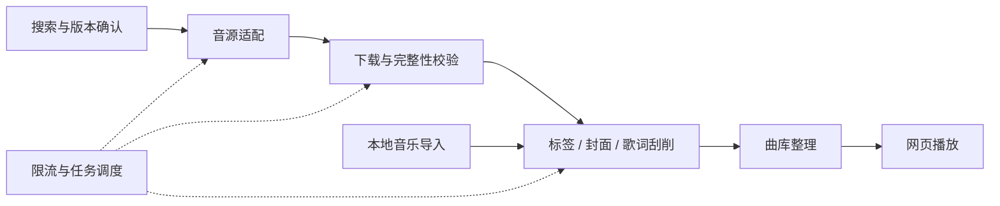

# 留声 · LiuSheng

### 歌单会变，喜欢的声音可以一直在。

**可扩展的自托管音乐服务**  
在线听歌、搜索与音源扩展，让下载和曲库整理有序发生。

*A self-hosted music service for listening, discovery and library automation.*

[核心能力](#核心能力) · [模块路线图](docs/ROADMAP.md) · [参与贡献](CONTRIBUTING.md) · [开放准备](docs/OPEN_SOURCE_PLAN.md)

> **私有预览阶段**：本仓库用于审阅 GitHub 项目主页与协作方案，目前仅包含展示文档，尚未迁入业务源码，也不能用于部署。Gitea 继续作为开发主仓库；转为公开需由维护者另行确认。

## 从找到一首歌，到整理好一座曲库

留声将搜索、试听、音源接入、下载、元数据刮削和曲库整理放进同一套工作流。你可以在网页里听歌，也可以让后台任务按设定的节奏整理音乐文件。

我们希望留声既能作为完整的自托管服务使用，也能逐步沉淀出便于扩展与复用的音乐处理模块。

## 核心能力

以下能力依据现有主项目实现与本地文档整理；不代表本预览仓库已包含对应代码。

| 能力 | 做什么 |
| --- | --- |
| **在线听歌** | 网页播放器、歌单与队列、同步歌词、系统播放控制 |
| **搜索与匹配** | 按歌名与歌手检索，确认版本；跨平台有歧义时保留待处理 |
| **音源与下载** | 导入兼容的 LX 脚本、检查来源能力、配置来源顺序，获取并校验音频 |
| **自动刮削** | 补齐缺失标签、封面与歌词；保留已有字段，支持人工锁定 |
| **曲库整理** | 本地扫描、目录归档、去重与补缺、歌单订阅、LRC 与 M3U8 |
| **限流与调度** | 任务启动间隔与频率控制、来源冷却、重试、暂停、取消和重启恢复 |

## 一条完整的音乐处理流程

音乐文件保存在自己的目录中。整理时优先保留已有信息；音频成功入库不等于歌词、封面等元数据全部成功，缺项和失败需要明确记录。

## 面向用户，也面向开发者

**自己使用**：部署一套服务，在网页里搜索、听歌，管理音源和音乐文件，让下载与刮削任务按节奏执行。

**参与开发**：从音源适配、匹配规则、元数据刮削、文件整理和限流策略切入，逐步明确模块接口与测试边界。

现有能力仍位于同一个主服务中。**独立 SDK、可单独安装的模块包和稳定插件协议尚未发布**，模块化拆分是后续方向。

## 技术组成

| 层次 | 技术与职责 |
| --- | --- |
| 网页 | Vue 3、TypeScript、Vite |
| 服务端 | FastAPI、SQLite、持久任务 |
| 媒体处理 | FFmpeg / ffprobe、标签与歌词处理 |
| 音源执行 | 独立 LX 执行容器 |
| 部署 | Docker Compose；通用部署配置待整理 |

主项目后端与网页的本地发布记录为 **2.2.1**。这不是 GitHub Release，也不表示本仓库已经提供可安装版本。

## 使用与范围

- 正式源码及通用部署指南准备好后，将补充首次安装、配置音源、导入音乐与任务管理说明。
- 本项目不提供公共音乐账号、公共曲库或歌曲文件。
- 第三方来源的能力、可用性与使用条件各不相同；请仅处理有权使用的内容。
- 音频、第三方音源脚本和个人运行配置不随展示文档分发。
- 项目后续聚焦网页与通用服务模块，不再推进 Android 客户端。App Store 是后续发行意向，尚无上架时间或下载入口。

## 接下来做什么

- 整理可移植的部署配置和开发文档。
- 明确音源、下载、刮削、整理、限流模块的输入输出与错误模型。
- 补充合成测试素材、适配示例和故障排查。
- 完善网页中搜索、试听、播放与任务状态的连贯体验。

详见 [模块路线图](docs/ROADMAP.md)。

## Gitea 开发，GitHub 相遇

Gitea 保留为开发主仓库。GitHub 计划承担作品展示、问题反馈与外部贡献入口，让贡献者无需注册自建服务。

预期流程：GitHub Issue / PR → 维护者审核 → 整合到 Gitea → 同步公开分支 → 在原 PR 回贴整合提交和处理结果。**本轮没有建立自动镜像**；Issue、PR、讨论和 Release 附件也不会随着 Git 提交自动同步。

见 [贡献指南](CONTRIBUTING.md) 和 [开放准备方案](docs/OPEN_SOURCE_PLAN.md)。

## 许可与致谢

许可证尚未选定，当前预览不构成开源授权。正式开放前需核对代码权属、依赖许可证、第三方脚本与资源边界，并结合后续发行计划确定许可。

感谢 Vue、FastAPI、FFmpeg 等上游项目。第三方依赖与许可证清单将在源码开放前补齐。
