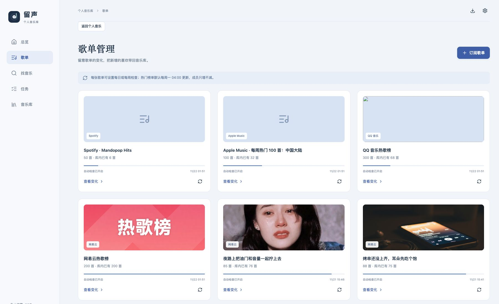
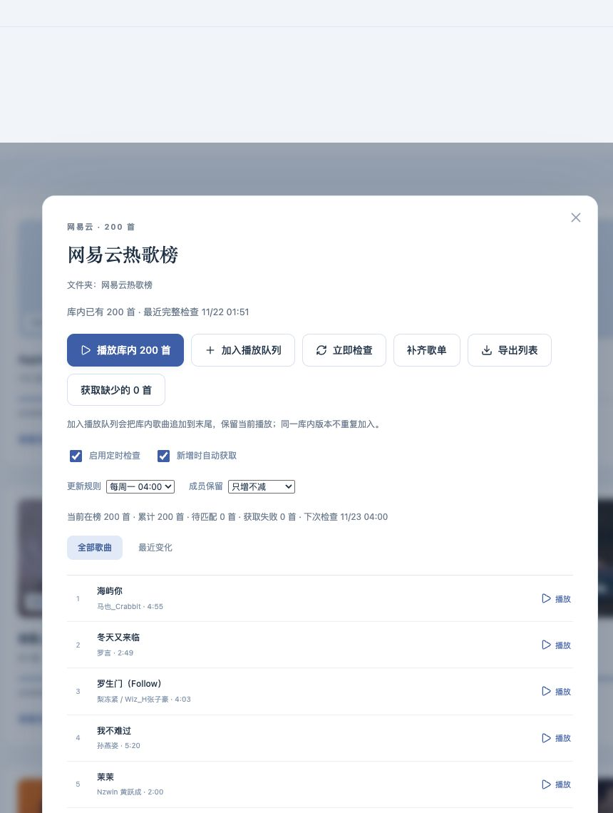
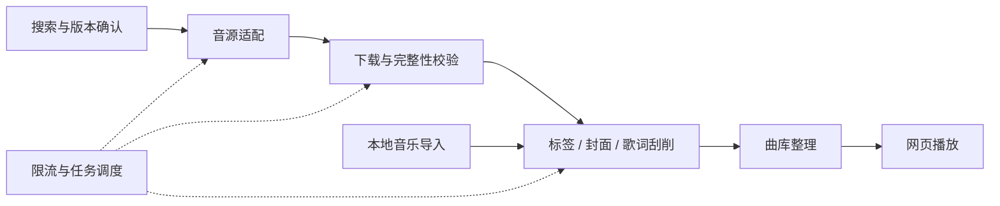

# 留声 · LiuSheng

### 歌单会变，喜欢的声音可以一直在。

**可扩展的自托管音乐服务**  
在线听歌、搜索与音源扩展，让下载和曲库整理有序发生。

*A self-hosted music service for listening, discovery and library automation.*

[部署指南](docs/DEPLOYMENT.md) · [核心能力](#核心能力) · [处理流程](#一条完整的音乐处理流程) · [技术组成](#技术组成)

> 当前提供网页、服务端与音源执行器源码，部署请参阅 [部署指南](docs/DEPLOYMENT.md)。独立模块包尚未发布。

## 从找到一首歌，到整理好一座曲库

留声将搜索、试听、音源接入、下载、元数据刮削和曲库整理放进同一套工作流。你可以在网页里听歌，也可以让后台任务按设定的节奏整理音乐文件。

我们希望留声既能作为完整的自托管服务使用，也能逐步沉淀出便于扩展与复用的音乐处理模块。

## 实际运行界面

以下截图来自实际运行的留声 v2.2.1（2026-11-22），展示热榜订阅与曲库管理。歌曲、数量及更新状态仅代表截图时的实例，不随仓库分发。

### 歌单与热榜管理

集中查看各平台歌单、已入库数量与自动检查状态。

### 热榜详情与自动更新

查看榜单歌曲、库内匹配结果，设置更新周期与成员保留规则。

## 核心能力

| 能力 | 做什么 |
| --- | --- |
| **在线听歌** | 网页播放器、歌单与队列、同步歌词、系统播放控制 |
| **搜索与匹配** | 按歌名与歌手检索，确认版本；跨平台有歧义时保留待处理 |
| **音源与下载** | 导入兼容的 LX 脚本、检查来源能力、配置来源顺序，获取并校验音频 |
| **自动刮削** | 补齐缺失标签、封面与歌词；保留已有字段，支持人工锁定 |
| **曲库整理** | 本地扫描、目录归档、去重与补缺、歌单订阅、LRC 与 M3U8 |
| **限流与调度** | 任务启动间隔与频率控制、来源冷却、重试、暂停、取消和重启恢复 |

## 一条完整的音乐处理流程

音乐文件保存在自己的目录中。整理时优先保留已有信息；音频成功入库不等于歌词、封面等元数据全部成功，缺项和失败需要明确记录。

## 技术组成

| 层次 | 技术与职责 |
| --- | --- |
| 网页 | Vue 3、TypeScript、Vite |
| 服务端 | FastAPI、SQLite、持久任务 |
| 媒体处理 | FFmpeg / ffprobe、标签与歌词处理 |
| 音源执行 | 独立 LX 执行容器 |
| 部署 | Docker Compose；容器内构建网页 |

## 使用与范围

- 首次使用请阅读 [部署指南](docs/DEPLOYMENT.md)，完成配置、构建与登录，再接入自己的音乐目录。
- 本项目不提供公共音乐账号、公共曲库或歌曲文件。
- 第三方来源的能力、可用性与使用条件各不相同；请仅处理有权使用的内容。
- 音频、第三方音源脚本和个人运行配置不随仓库分发。

## 许可与致谢

许可证待确定。

感谢 Vue、FastAPI、FFmpeg 等上游项目。
